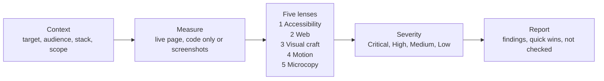

<picture>
  <source media="(prefers-color-scheme: dark)" srcset="assets/banner-dark.svg">
  <source media="(prefers-color-scheme: light)" srcset="assets/banner-light.svg">
  
</picture>

[](https://skills.sh/B-Riemer/claude-skills)
[](LICENSE)
[](https://github.com/B-Riemer/claude-skills/actions/workflows/validate-skills.yml)

Agent skills for [Claude Code](https://claude.com/claude-code) and any agent that supports the open skills format, built around one rule: findings carry evidence, or they are labeled as judgment.

## Why

Without guidance, a coding agent asked to "make this look better" tends to produce the same card grid, gradient and rounded-corner defaults, and a requested review tends to come back as a list of generic advice that does not point at anything on the actual page. Neither is checkable.

These skills constrain that behavior. They tell the agent what to measure (contrast ratios, target sizes, layout shift, focus path), in which order to look, how to rank what it finds, and how to separate observed facts from opinion. The output is a report you can verify line by line.

## Skills

| Skill | Purpose | Modes |
| --- | --- | --- |
| [`apple-design-pro`](skills/apple-design-pro/README.md) | Audit websites for accessibility, web-platform, visual-craft, motion and microcopy flaws, and build Apple-grade motion and interaction. Web only. | Review, Build |

## Install

With the [skills CLI](https://skills.sh):

```bash
npx skills add B-Riemer/claude-skills@apple-design-pro -g
```

As a Claude Code plugin marketplace:

```
/plugin marketplace add B-Riemer/claude-skills
/plugin install apple-design-pro@bjorvik-skills
```

## How it works

In review mode the skill follows a fixed sequence. It establishes context, measures where it can, runs five lenses in order, ranks the results by user impact, and reports.



What the skill can verify depends on its input. With a live URL and browser tooling it measures. With code only, it marks runtime findings as unconfirmed. With screenshots only, it does not report motion, focus, performance or responsiveness as clean. Details are in the [skill page](skills/apple-design-pro/README.md).

## Example output

Illustrative example, not a review of a real site. The domain is fictional.

```markdown
### [High] Body text fails contrast
**Problem:** On https://example.com/pricing, paragraph text is #8a8a8a on #ffffff,
a ratio of 3.4:1 (WCAG AA requires 4.5:1 for body text). Affects every `<p>` in
`.feature-list` (14 elements). Verified.
**Why it matters:** references/web-lens.md §4 (Color and contrast).
**Fix:** darken the text color token, e.g. `--text-secondary: #6b6b6b;` (about 5.3:1 on white).
```

## Design principles

- **Evidence over guesses.** Each finding is either Verified (measured or directly seen, with the value) or Assessment (judgment, with a way to check it).
- **Report, do not fix.** Review mode changes no code unless asked. Side observations are listed separately at the end.
- **Say what was not checked.** Skipped lenses and missing tooling are stated in the report, never papered over.
- **Rank by user impact.** Severity reflects harm to users, not the effort of the fix. An empty severity level is acceptable.
- **One root cause, one finding.** Repeats are grouped with a count and examples.
- **Web first.** Apple's Human Interface Guidelines are used for reasoning and translated to the web, not copied from iOS. Where a web convention is better, the skill says so.
- **Load only what is needed.** Reference files are opened per task instead of all at once.

## Repository layout

```
.
├── .claude-plugin/
│   └── marketplace.json      plugin marketplace manifest
├── .github/workflows/
│   └── validate-skills.yml   CI
├── assets/                   banner images
├── scripts/
│   └── validate_skills.py    frontmatter, link and manifest checks
├── skills/
│   └── apple-design-pro/
│       ├── SKILL.md
│       ├── README.md
│       └── references/       web-lens, motion-principles, visual-craft, hig-links
├── CHANGELOG.md
├── LICENSE
└── README.md
```

## Credits

- `skills/apple-design-pro/references/motion-principles.md` is adapted from [emilkowalski/skills](https://github.com/emilkowalski/skills) (`apple-design`), MIT License, Copyright (c) 2026 Emil Kowalski. The license text is included in that file.
- Apple's Human Interface Guidelines are linked, not copied. All other text is my own.

## License

MIT, see [LICENSE](LICENSE).
